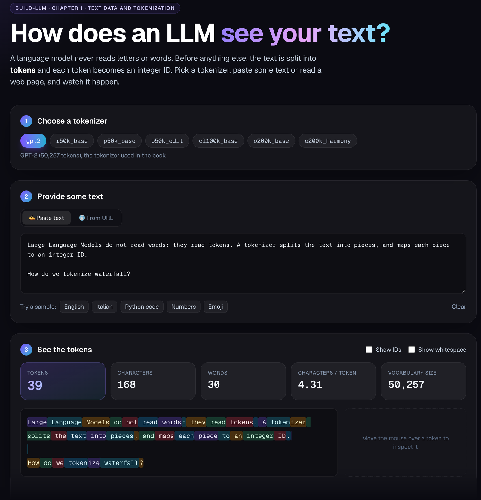

# Build a LLM

[](https://www.python.org/downloads/)
[](https://pytorch.org/)
[](https://github.com/psf/black)
[](https://github.com/pylint-dev/pylint)
[](https://docs.pytest.org/)
[](LICENSE)

> **Build a small Large Language Model from scratch, one transparent step at a
> time, in plain Python and PyTorch.**

Large Language Models often feel like black boxes. This repository opens the
box, one component at a time: from raw text to tokens, from tokens to
attention, and on to a small GPT-style model that you can train and run on a
laptop.

No magic, no hidden frameworks: each piece is small, readable, and explained,
so that you can understand *why* it works, not only *that* it works.

> **Status: work in progress.** Chapters 0 to 4 are available: environment,
> tokenization and data loading, attention up to multi-head causal attention,
> the architecture of a GPT-2-like model, loading the pretrained GPT-2
> weights to generate text, and a first training loop. New chapters are added
> as the project grows; see the [roadmap](#roadmap).

<p align="center">
  
</p>
<p align="center">
  <em>The Tokenizer explorer of <a href="chap1/README.md">Chapter 1</a>: see how GPT tokenizers split your text, token by token.</em>
</p>

## Is this for you?

This repository is useful if you:

* want to understand how a GPT model works **inside**, not only how to call
  one through an API;
* are reading, or plan to read,
  [*Build a Large Language Model (From Scratch)*](https://www.manning.com/books/build-a-large-language-model-from-scratch)
  by Sebastian Raschka, and want a second, hands-on path through the same
  ideas, with demos and short answers to common questions;
* learn best by running code, changing a value, and seeing what happens;
* have a Mac with Apple Silicon and want to use its GPU with PyTorch.

**What you need**: Python and basic programming. Some familiarity with
PyTorch and with vectors and matrices helps, but each concept is introduced
from the start. Any recent laptop is enough: the reference machine is a
MacBook with Apple Silicon, and the code also runs on Linux and Windows, on
CPU or on a CUDA GPU.

It is probably **not** what you are looking for if you want to train large
models, a production-ready library, or the official code of the book (that
is [rasbt/LLMs-from-scratch](https://github.com/rasbt/LLMs-from-scratch)).

## What you will learn

* How text becomes numbers: BPE tokenization, token IDs, and embeddings.
* How training data for next-token prediction is built, with sliding windows
  and PyTorch data loaders.
* How self-attention works, from a few lines of matrix algebra to the
  multi-head attention inside a transformer block.
* How the pieces fit into a GPT model that you pre-train, evaluate, and use
  to generate text.
* How to run all of it on a laptop, using the Apple Silicon GPU through MPS.

## How this repository relates to the book

This is an independent learning project, born while re-reading Sebastian
Raschka's book: a collection of what I explored and built along the way. It
is not an official companion of the book. For the full story behind every
concept, read the book; for its complete code, see its
[companion repository](https://github.com/rasbt/LLMs-from-scratch).

What you find here in addition:

* **Interactive demos**, such as the Tokenizer explorer, with a web UI and a
  command-line tool.
* **Reusable, tested code**: the building blocks live in the `build_llm`
  package, with `pytest` tests, and every script runs with `python -m`.
* **Questions and answers** by chapter: short answers to the questions that
  come up while studying, in [docs/questions-and-answers.md](docs/questions-and-answers.md).
* **Apple Silicon first**: the code is developed and optimized on a MacBook,
  using PyTorch's [MPS backend](https://pytorch.org/docs/stable/notes/mps.html)
  when it is available, and falling back to CUDA or CPU elsewhere.

Some notebooks and modules are derived from the companion repository: see
[Acknowledgements and licenses](#acknowledgements-and-licenses).

## Chapters

The chapter numbers of this repository differ from the book.

| Chapter | Topic | What you get | Book chapter |
| --- | --- | --- | --- |
| [Chap 0](chap0/README.md) | Environment | A check of Python, packages, and MPS acceleration | — |
| [Chap 1](chap1/README.md) | Text data and tokenization | The Tokenizer explorer (web UI and CLI), and a notebook on the data loader for next-token prediction | 2 |
| [Chap 2](chap2/README.md) | Self-attention | Four notebooks: simplified attention, scaled attention with trainable query, key, and value projections, causal attention with dropout, and multi-head attention | 3 |
| [Chap 3](chap3/README.md) | GPT architecture | Two notebooks: a dummy GPT model, from token IDs to logits, and the complete GPT-2-like model built step by step, with its architecture diagram and parameter count | 4 |
| [Chap 4](chap4/README.md) | Pretrained weights and first training | A notebook that loads the GPT-2 Small weights from Hugging Face, without TensorFlow, and generates text; a script that trains the model from random weights on 31 public-domain books, over 10 million tokens, tracking the training and validation losses | 5 |

## Getting started

To set up the environment and run the chapters, follow the
[Quickstart](QUICKSTART.md). In short: create the `build-llm` Conda
environment with Python 3.11, install `requirements.txt` and
`requirements-dev.txt`, and run `python -m chap0.check_environment`. Then
start from [Chapter 1](chap1/README.md).

## Roadmap

✅ implemented, 🚧 in progress, ⬜ planned.

- ✅ **Text data and tokenization**: from raw text to token IDs with Byte
  Pair Encoding (BPE) and tiktoken, and the Tokenizer explorer demo
  ([Chapter 1](chap1/README.md)).
- ✅ **Data pipeline**: sliding-window datasets and data loaders for
  next-token prediction ([Chapter 1 notebook](chap1/dataloader.ipynb), and
  the reusable `build_llm/dataloaders.py`).
- 🚧 **Embeddings**: token and positional embeddings.
- ✅ **Attention**: simplified self-attention, trainable query, key, and
  value projections, causal attention with dropout, and multi-head attention
  ([Chapter 2](chap2/README.md)).
- ✅ **GPT architecture**: layer normalization, GELU, feed-forward blocks,
  transformer blocks, and the full GPT model, with its parameter count
  ([Chapter 3](chap3/README.md)).
- 🚧 **Text generation**: greedy decoding ([Chapter 4](chap4/README.md));
  next, temperature and top-k sampling.
- 🚧 **Pre-training**: cross-entropy loss and a training loop with AdamW, on
  31 public-domain books (over 10 million tokens), with a training and
  validation split per book
  ([`chap4/first_training.py`](chap4/first_training.py)), with a checkpoint
  at the end of every epoch and resume with `--resume`.
- 🚧 **Evaluation**: training and validation loss during training, which show
  when the model starts to overfit
  ([`chap4/first_training.py`](chap4/first_training.py)); next, perplexity.
- ✅ **Loading pretrained weights**: load the public GPT-2 Small weights,
  in the safetensors format, into our model ([Chapter 4](chap4/README.md)).
- ⬜ **Fine-tuning**: classification fine-tuning and instruction fine-tuning.

## Repository layout

```text
build-llm/
├── build_llm/            # Reusable package with the LLM building blocks
├── chap0/                # Chapter 0: check of the development environment
├── chap1/                # Chapter 1: text data and tokenization
│   └── ui/               # Web UI of the tokenizer demo (Next.js)
├── chap2/                # Chapter 2: self-attention, up to multi-head attention
├── chap3/                # Chapter 3: the GPT model architecture
├── chap4/                # Chapter 4: pretrained GPT-2 weights, first training
├── docs/                 # Guides, such as the questions and answers by chapter
├── images/               # Images used in the documentation
├── models/               # Downloaded model weights (ignored by Git)
├── tests/                # pytest test suite
├── LICENSES/             # Licenses of third-party material
├── QUICKSTART.md         # Setup, environment check, and development checks
├── CONTRIBUTING.md       # How to ask questions, report problems, contribute
├── AI_ASSISTANCE.md      # How AI assistants helped review and improve the material
├── NOTICE                # Attributions: what comes from where, and its license
├── AGENTS.md             # Rules for contributors and coding agents
├── pyproject.toml        # Project metadata and tool configuration
├── requirements.txt      # Runtime dependencies
└── requirements-dev.txt  # Development tools and JupyterLab
```

## Contributing

Questions, corrections, and suggestions are welcome. Read
[CONTRIBUTING.md](CONTRIBUTING.md) to see how to ask a question, report a
problem, or propose a change.

## Acknowledgements and licenses

Many thanks to **Sebastian Raschka** for the book and for the
[LLMs-from-scratch](https://github.com/rasbt/LLMs-from-scratch) repository,
which made this project possible.

* The notebooks `chap1/dataloader.ipynb`, `chap2/basic_attention.ipynb`,
  `chap2/attention.ipynb`, `chap2/causal_attention.ipynb`,
  `chap2/multi_head_attention.ipynb`, `chap3/dummy_gpt.ipynb`, and
  `chap3/gpt_step_by_step.ipynb`, the modules `build_llm/gpt2.py` and
  `build_llm/dataloaders.py`, and the script `chap4/first_training.py` are
  derived from the notebooks of LLMs-from-scratch,
  Copyright 2023-2026 Sebastian Raschka, licensed under the
  [Apache License 2.0](LICENSES/Apache-2.0-LLMs-from-scratch.txt). They were
  modified for this repository, and each one states its origin.
* `chap1/the-verdict.txt` is the short story "The Verdict" by Edith Wharton
  (1908), in the public domain, taken from the same repository.
* The 31 books in `chap4/books/` used for training, such as "The Time Machine"
  by H. G. Wells and "Pride and Prejudice" by Jane Austen, are in the public
  domain. They were converted to plain text from the
  [Standard Ebooks](https://standardebooks.org/) editions, whose
  contributions are dedicated to the public domain under CC0 1.0. The list is
  in the [Chapter 4 README](chap4/README.md), the sources in NOTICE.
* This repository does not include text or figures from the book.

The details are in [NOTICE](NOTICE).

The material was reviewed and improved with the help of AI coding assistants
(Codex and Claude): [AI_ASSISTANCE.md](AI_ASSISTANCE.md) explains how.

## License

The original code and documentation of this repository are released under
the [MIT License](LICENSE). The derived files listed above keep the
[Apache License 2.0](LICENSES/Apache-2.0-LLMs-from-scratch.txt).
