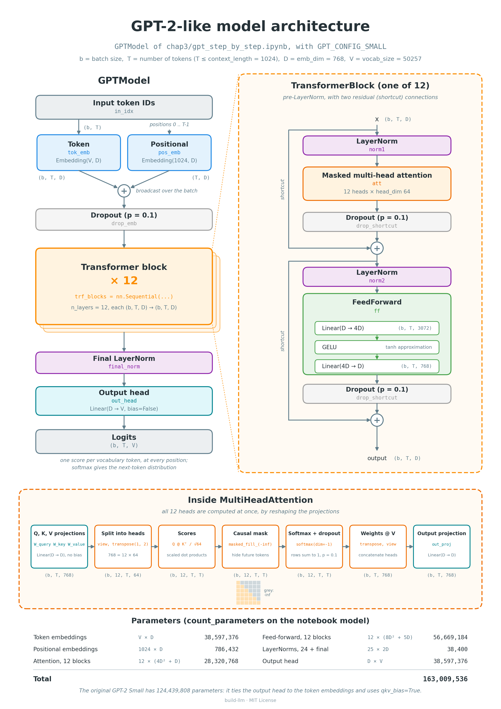

# Chapter 3: the GPT model architecture

This chapter assembles the components of a GPT-2-like model. It starts from a
dummy model that already has the full data flow, from token IDs to logits,
with placeholders for the transformer block and the layer normalization. Then
it builds the real components, one at a time, and assembles the complete
model.

<p align="center">
  
</p>

The notebooks follow the GPT examples in Chapter 4 of Sebastian Raschka's
*Build a Large Language Model (From Scratch)* and its
[companion notebook](https://github.com/rasbt/LLMs-from-scratch/blob/main/ch04/01_main-chapter-code/ch04.ipynb).
The chapter numbering in this repository differs from the book.

## Notebooks and reading order

1. **[A dummy GPT model](dummy_gpt.ipynb)**: define the GPT-2 Small
   configuration and a `DummyGPTModel` with token and position embeddings,
   dropout, a stack of placeholder transformer blocks, a placeholder final
   normalization, and the output head. Then count the parameters actually
   present in the dummy model, and estimate those of the complete
   architecture with `build_llm.model_parameters`: about 163M parameters with
   separate input and output weights, and the familiar 124M of GPT-2 Small
   with tied embeddings and query, key, and value biases.
2. **[GPT-2 step by step](gpt_step_by_step.ipynb)**: build the real
   components, with an explanation of each one: multi-head causal attention,
   layer normalization, the GELU activation, the feed-forward network, and
   the transformer block with pre-LayerNorm and residual connections. Then
   assemble them into `GPTModel`, count its parameters, check that the count
   matches the estimate, and see why it differs from the 124M of the original
   GPT-2 Small.

## Run the notebooks

Follow the [Quickstart](../QUICKSTART.md) to create the `build-llm` Conda
environment, install the dependencies, and install the repository in editable
mode. The notebooks import `build_llm`, so the editable installation is
required.

From the repository root:

```bash
conda activate build-llm
```

```bash
python -m jupyterlab
```

Open the notebooks in the order above, with the Python kernel from the
`build-llm` environment, and run each one from top to bottom. If the kernel
cannot import `build_llm`, restart it and run all cells again.

The models are created on PyTorch's `meta` device, which records tensor
shapes without allocating the weights, so counting the parameters of a
model of this size needs almost no memory. The notebooks require no
datasets, downloaded weights, or network access.

## Follow the tensor shapes

| Step | Shape |
| --- | --- |
| Input token IDs | `(batch_size, seq_len)` |
| Token embeddings | `(batch_size, seq_len, emb_dim)` |
| Position embeddings | `(seq_len, emb_dim)`, broadcast over the batch |
| Output of each transformer block | `(batch_size, seq_len, emb_dim)` |
| Logits | `(batch_size, seq_len, vocab_size)` |

`seq_len` cannot exceed `context_length`, the number of rows of the position
embedding table. The logits are scores, not probabilities: softmax turns the
logits at one position into the distribution of the next token.

## Scope and next steps

`GPTModel` is complete but untrained: its weights are random, so its logits
are not meaningful yet. Its configuration has the dimensions of GPT-2 Small,
but without weight tying and without query, key, and value biases, so it has
about 163M parameters instead of 124M.

The next steps use the model: generate text from the logits, and then
pre-train it.

## Development checks

From the repository root, with the `build-llm` environment active:

```bash
black .
```

```bash
pylint build_llm chap* tests
```

```bash
pytest
```

The pytest suite tests `build_llm.model_parameters`; it does not execute the
notebooks. Verify the notebooks separately with a fresh kernel and
**Run All Cells**.
